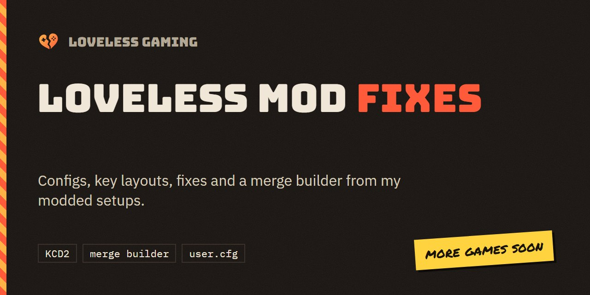

# Loveless Mod Fixes

Fixes, configs and know-how from heavily modded setups, published so other players don't have to rediscover them. One folder per game.

**Download:** get the zip for your game from [the latest release](../../releases/latest). Questions? Ask in the [Discord](https://discord.gg/qcmgVa2Fx6).

| Game | Folder | What's there |
|---|---|---|
| Kingdom Come: Deliverance II | [`kcd2/`](kcd2/) | **Merge builder** (merges overlapping files from your installed mods), tuned `user.cfg`, a key scheme that ends the F-key clashes, small fixes, experimental console scripts |

More games (Kenshi, Terraria, The Sims 3, Project Zomboid) are on the way.

## How this repo handles other people's mods

Some of these fixes started life as edits to other authors' mods. Their files are theirs, so this repo **doesn't re-upload them**. Instead you'll find:

- **Our own work**, like configs, scripts and guides, MIT licensed.
- **Instructions** for small changes you make to your own copy of a mod.
- **Builder scripts** that work on the copies *you* already installed, on your PC. For example, the [KCD2 merge builder](kcd2/merge-builder/) merges your mods' overlapping files locally.

If you're the author of a mod mentioned here and want something changed or credited differently, open an issue or ask in the [Discord](https://discord.gg/qcmgVa2Fx6).

## Related

- [Loveless Mod Consoles](https://github.com/ResurexXxion/loveless-mod-consoles): live log consoles and crash post-mortems for KCD2, Kenshi and Mass Effect LE.
- Full setups with credits and lessons: [lovelessgaming.com/mods](https://lovelessgaming.com/mods/).

Made by Loveless Gaming, written with the help of Claude (Anthropic). MIT licensed: see [LICENSE](LICENSE).
